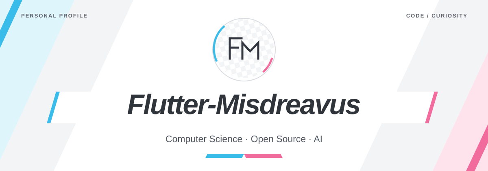

<picture>
  <source media="(prefers-color-scheme: dark)" srcset="assets/hero-dark.svg">
  
</picture>

  <a href="#about">About</a> &nbsp;·&nbsp;
  <a href="#contributions">Contributions</a>

## About

<picture>
  <source media="(prefers-color-scheme: dark)" srcset="assets/section-dark.svg">
  
</picture>

I'm **Flutter-Misdreavus**, a **Computer Science undergraduate at Central South University**.

An avid reader and open-source enthusiast, I'm exploring AI and following my curiosity through the history of science and paleontology.

## Contributions

<picture>
  <source media="(prefers-color-scheme: dark)" srcset="assets/section-dark.svg">
  
</picture>

<picture>
  <source media="(prefers-color-scheme: dark)" srcset="https://raw.githubusercontent.com/Flutter-Misdreavus/Flutter-Misdreavus/output/github-contribution-grid-snake-dark.svg">
  
</picture>

<picture>
  <source media="(prefers-color-scheme: dark)" srcset="assets/footer-dark.svg">
  
</picture>
